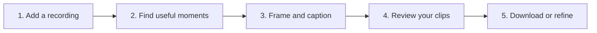
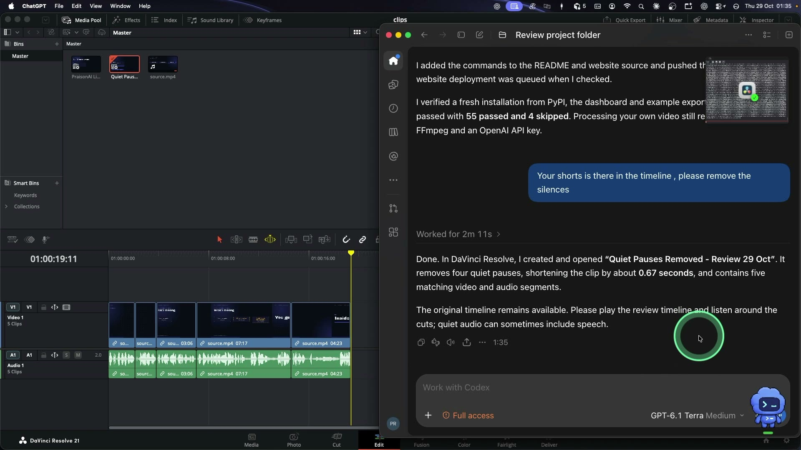
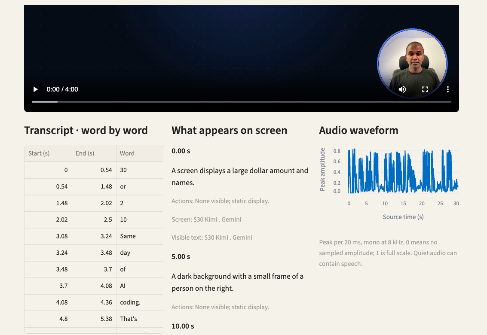
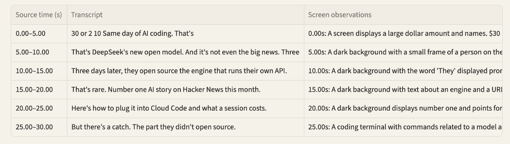

> This project was built with **OpenAI Codex**, under Mervin Praison’s direction, and prepared for the [Cambridge Codex Community Challenge](https://cambridge-codex-workshop-guide.lilizhu.chatgpt.site/challenges.html).

# PraisonAI Clips

[](https://clips.praison.ai/)

[**View on ChatGPT Sites →**](https://clips.praison.chatgpt.site/)

### Turn one long video into short clips you can review and share.

Bring an interview, lesson, webinar, or walkthrough. PraisonAI Clips finds moments, frames them for vertical video, adds captions, and gives you the final say. You can also ask Codex to make live edits in your video editor while you watch.

**Install and open the app**

```sh
python -m pip install praisonai-clips
praisonai-clips studio
```

For your own videos, you also need Python 3.11+, a compatible FFmpeg installation, and an OpenAI API key. [See the setup guide](docs/getting-started/installation.md).

**REAL-TIME EDITING**

<a href="docs/reference/resolve-sdk.md"></a> &nbsp; [**DaVinci Resolve**](docs/reference/resolve-sdk.md) &nbsp;&nbsp;&nbsp; <a href="docs/KDENLIVE_LIVE_CONTROL.md"></a> &nbsp; [**Kdenlive**](docs/KDENLIVE_LIVE_CONTROL.md)

Ask Codex to adjust framing and see the result in your open editor. Resolve also supports creating a review timeline with quiet pauses removed. Setup and supported operations differ by editor.

[**Watch the example**](https://clips.praison.ai/#see-example) · [**Watch Codex edit in Resolve**](https://clips.praison.ai/#live-edit-demo) · [**See the walkthrough**](https://clips.praison.ai/built-with-codex/#watch-the-walkthrough) · [Get started](#get-started) · [Edit by chatting](#edit-in-resolve-by-chatting)

## See it before you set anything up

[](https://clips.praison.ai/built-with-codex/#watch-the-walkthrough)

**↑ Select the image to open the 66-second walkthrough.** Or [watch the short clip](https://clips.praison.ai/#see-example) and [compare it with its original](https://clips.praison.ai/assets/demo/source.mp4). The example is free to explore: no account, API key, or installation is needed.

The example is silent, generated media with scripted captions. It shows the output format and app experience; it does not show a new AI selection or a live Resolve edit.

## How it works



| You bring | You get | You decide |
| --- | --- | --- |
| A video on your computer | Vertical videos with captions and downloadable files | Which clips to keep, edit, and share |

Choose where to stop: analyze the source, review selected moments, or create finished review clips in one run. You can resume from a saved stage. Import a rendered clip into DaVinci Resolve or Kdenlive and, after setup, ask Codex for supported further edits. The rendered crop and captions are baked into the video; editable source-cut export is available separately for Kdenlive. [Explore the full workflow](docs/guides/workflow.md).

The app aims for up to five clips of 30–60 seconds each. It may find fewer suitable clips. Results that need another look appear as drafts.

## Edit in Resolve by chatting

[](https://clips.praison.ai/assets/live-edit/resolve-demo.mp4)

**▶ Watch the 30-second live-editing demo.** Codex creates a separate review timeline after a request to remove quiet pauses. The recording is shortened and has no narration; the [demo notes](https://clips.praison.ai/built-with-codex/#watch-the-live-editing-demo) explain the intervention used in that run.


With DaVinci Resolve open, you can ask Codex to inspect a timeline and make an edit you can see in the editor. For example:

> “Zoom in on the speaker.”
>
> “Find the quiet pauses in this clip and make a new timeline so I can review the cuts.”

The pause workflow creates a separate timeline for review. In a real Mac test, a 20-second excerpt became six video and audio segments, with 0.9 seconds of quiet pauses removed.

[**Set up Codex for live editing →**](docs/getting-started/codex.md) · [Resolve SDK](docs/reference/resolve-sdk.md) · [CLI and YAML](docs/reference/cli.md#remove-quiet-pauses)

<details>
<summary><strong>How do I connect Codex?</strong></summary>

Open this repository in Codex and ask: “Help me set up PraisonAI Clips to edit my open Resolve project.” The included `resolve-mac-live` skill guides Codex through the tested Mac setup. For direct editor tools, install the optional MCP server and register it with Codex; the [step-by-step guide](docs/getting-started/codex.md) covers both Resolve and Kdenlive.

</details>

Resolve live control was tested with DaVinci Resolve Free 21.1 on macOS. Pause removal currently supports an unretimed 30 fps source clip on a 30 fps timeline. Quiet passages can contain speech, so listen to the cuts before sharing.

## Get started

**Just looking?** [Play the example](https://clips.praison.ai/#see-example). You can also download its example files from the app without an API key.

**Ready to use your own video?** The app runs on your computer. You’ll need Python 3.11+, FFmpeg with subtitle and H.264 support, and an OpenAI API key. OpenAI analyzes audio and sampled frames and charges for API usage; the source files and results stay in your local workspace.

Install the package and start the dashboard:

```sh
python -m pip install praisonai-clips
praisonai-clips studio
```

1. [Follow the installation guide](docs/getting-started/installation.md) to install the app and its prerequisites.
2. Add your OpenAI API key as described in the guide.
3. Start the dashboard and add a recording.
4. Review the clips, listen, and download the ones you want.

### See the evidence together

After processing starts, select your recording and open **Source evidence**. Choose a time window to see the source video and three side-by-side views:



*A real dashboard view from an analyzed recording. Word timings are estimates and screen descriptions come from sampled frames.*

| Transcript | What appears on screen | Audio waveform |
| --- | --- | --- |
| Words with estimated start and end times | Descriptions of frames sampled about every five seconds | Local audio peaks across the same source-time window |

A comparison table maps the three views to five-second source intervals. Its audio value is the maximum sampled peak, not average loudness. The transcript and screen descriptions appear as their processing stages finish; use **Refresh source evidence** to update them. The panel makes no additional AI calls. Playback does not automatically follow the chart. Listen and inspect before accepting cuts: quiet audio and estimated timestamps are not proof that speech is absent.



*The comparison table in the dashboard. This screenshot shows part of the table; the audio column is outside the captured area.*

<details>
<summary><strong>Show the setup commands</strong></summary>

Open Terminal and run:

```sh
git clone https://github.com/MervinPraison/praisonai-clips.git
cd praisonai-clips
python3 -m venv .venv
source .venv/bin/activate
python -m pip install -e .
cp -n .env.example .env
```

Add your `OPENAI_API_KEY` to `.env`, then check your setup and open the app:

```sh
praisonai-clips doctor --check
streamlit run app.py
```

Open [localhost:8501](http://127.0.0.1:8501). Upload a file up to 2 GB, or choose a local file path for a larger recording. The [installation guide](docs/getting-started/installation.md) covers FFmpeg and platform-specific setup.

</details>

<details>
<summary><strong>Prefer the command line?</strong></summary>

```sh
praisonai-clips example --output example.zip
praisonai-clips run /path/to/video.mp4
praisonai-clips list
praisonai-clips manifest JOB_ID
praisonai-clips bundle JOB_ID clip-01 --output clip.zip
praisonai-clips preview --serve
```

Replace `JOB_ID` with the ID returned by the app. The [CLI reference](docs/reference/cli.md) covers job management, Resolve editing, and YAML commands.

</details>

<details>
<summary><strong>What is included in a clip?</strong></summary>

A downloadable bundle contains the video, SRT and ASS captions, word timings, edit mapping, and review evidence. Uncertain clips remain in drafts for closer inspection. [See the file guide](docs/reference/configuration.md).

</details>

<details>
<summary><strong>Can I use Kdenlive?</strong></summary>

Yes. You can export editable source cuts and caption sidecars, or use live framing controls. Setup and behavior differ from Resolve; see the [Kdenlive guide](docs/KDENLIVE_LIVE_CONTROL.md).

</details>

## Built to be checked

You decide what to publish. Preview the framing, check the captions, and listen to the audio. Automated review checks the render and samples frames, but it cannot catch every issue.

[See what was made, changed, and checked](https://clips.praison.ai/built-with-codex/) · [Read the real-video validation report](docs/reference/validation-report.md) · [View automated checks](https://github.com/MervinPraison/praisonai-clips/actions/workflows/verify.yml)

## Explore further

[Product overview](docs/product.md) · [Full documentation](https://clips.praison.ai/) · [Resolve SDK](docs/reference/resolve-sdk.md) · [Data handling](docs/reference/public-release.md) · [Contributing and architecture](docs/development/architecture.md)

PraisonAI Clips uses third-party tools and components, including OpenAI, FFmpeg, Streamlit, MkDocs Material, and optional editor integrations. Their license notices and attribution are retained in the project.

DaVinci Resolve is a trademark of Blackmagic Design. Kdenlive™, Kde’n’live™ and the playhead logo are trademarks of KDE e.V.
