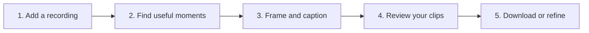

> **Built entirely using OpenAI Codex**, under Mervin Praison’s direction.

# PraisonAI Clips

### Turn one long video into short clips you can review and share.

Bring an interview, lesson, webinar, or walkthrough. PraisonAI Clips finds moments, frames them for vertical video, adds captions, and gives you the final say. You can also ask Codex to make live edits in DaVinci Resolve while you watch.

[**Watch the example**](https://clips.praison.ai/#see-example) · [**See the walkthrough**](https://clips.praison.ai/built-with-codex/#watch-the-walkthrough) · [Get started](#get-started) · [Edit by chatting](#edit-in-resolve-by-chatting)

## See it before you set anything up

[](https://clips.praison.ai/built-with-codex/#watch-the-walkthrough)

**↑ Select the image to open the 66-second walkthrough.** Or [watch the short clip](https://clips.praison.ai/#see-example) and [compare it with its original](https://clips.praison.ai/assets/demo/source.mp4). The example is free to explore: no account, API key, or installation is needed.

The example is silent, generated media with scripted captions. It shows the output format and app experience; it does not show a new AI selection or a live Resolve edit.

## How it works



| You bring | You get | You decide |
| --- | --- | --- |
| A video on your computer | Vertical videos with captions and downloadable files | Which clips to keep, edit, and share |

The app aims for up to five clips of 30–60 seconds each. It may find fewer suitable clips. Results that need another look appear as drafts.

## Edit in Resolve by chatting

With DaVinci Resolve open, you can ask Codex to inspect a timeline and make an edit you can see in the editor. For example:

> “Zoom in on the speaker.”
>
> “Find the quiet pauses in this clip and make a new timeline so I can review the cuts.”

The pause workflow creates a separate timeline for review. In a real Mac test, a 20-second excerpt became six video and audio segments, with 0.9 seconds of quiet pauses removed.

[**Connect Codex to Resolve →**](docs/reference/resolve-sdk.md) · [Mac setup](skills/resolve-mac-live/references/runbook.md) · [CLI and YAML](docs/reference/cli.md#remove-quiet-pauses)

Resolve control is experimental and was tested with DaVinci Resolve Free 21.1 on macOS. Pause removal currently supports an unretimed 30 fps source clip on a 30 fps timeline. Quiet passages can contain speech, so listen to the cuts before sharing.

## Get started

**Just looking?** [Play the example](https://clips.praison.ai/#see-example). You can also download its example files from the app without an API key.

**Ready to use your own video?** The app runs on your computer. You’ll need Python 3.11+, FFmpeg with subtitle and H.264 support, and an OpenAI API key. OpenAI analyzes audio and sampled frames and charges for API usage; the source files and results stay in your local workspace.

1. [Follow the installation guide](docs/getting-started/installation.md) to install the app and its prerequisites.
2. Add your OpenAI API key as described in the guide.
3. Start the dashboard and add a recording.
4. Review the clips, listen, and download the ones you want.

<details>
<summary><strong>Show the setup commands</strong></summary>

Open Terminal and run:

```sh
git clone https://github.com/MervinPraison/praisonai-clips.git
cd praisonai-clips
python3 -m venv .venv
source .venv/bin/activate
python -m pip install -e .
cp -n .env.example .env
```

Add your `OPENAI_API_KEY` to `.env`, then check your setup and open the app:

```sh
praisonai-clips doctor --check
streamlit run app.py
```

Open [localhost:8501](http://127.0.0.1:8501). Upload a file up to 2 GB, or choose a local file path for a larger recording. The [installation guide](docs/getting-started/installation.md) covers FFmpeg and platform-specific setup.

</details>

<details>
<summary><strong>Prefer the command line?</strong></summary>

```sh
praisonai-clips example --output example.zip
praisonai-clips run /path/to/video.mp4
praisonai-clips list
praisonai-clips manifest JOB_ID
praisonai-clips bundle JOB_ID clip-01 --output clip.zip
praisonai-clips preview --serve
```

Replace `JOB_ID` with the ID returned by the app. The [CLI reference](docs/reference/cli.md) covers job management, Resolve editing, and YAML commands.

</details>

<details>
<summary><strong>What is included in a clip?</strong></summary>

A downloadable bundle contains the video, SRT and ASS captions, word timings, edit mapping, and review evidence. Uncertain clips remain in drafts for closer inspection. [See the file guide](docs/reference/configuration.md).

</details>

<details>
<summary><strong>Can I use Kdenlive?</strong></summary>

Yes. You can export editable source cuts and caption sidecars, or use experimental live framing controls. Setup and behavior differ from Resolve; see the [Kdenlive guide](docs/KDENLIVE_LIVE_CONTROL.md).

</details>

## Built to be checked

You decide what to publish. Preview the framing, check the captions, and listen to the audio. Automated review checks the render and samples frames, but it cannot catch every issue.

[See what was made, changed, and checked](https://clips.praison.ai/built-with-codex/) · [Read the real-video validation report](M0_REPORT.md) · [View automated checks](https://github.com/MervinPraison/praisonai-clips/actions/workflows/verify.yml)

## Explore further

[Product overview](docs/product.md) · [Full documentation](https://clips.praison.ai/) · [Resolve SDK](docs/reference/resolve-sdk.md) · [Data handling](docs/reference/public-release.md) · [Contributing and architecture](architecture.md)

PraisonAI Clips uses third-party tools and components, including OpenAI, FFmpeg, Streamlit, MkDocs Material, and optional editor integrations. Their license notices and attribution are retained in the project.
