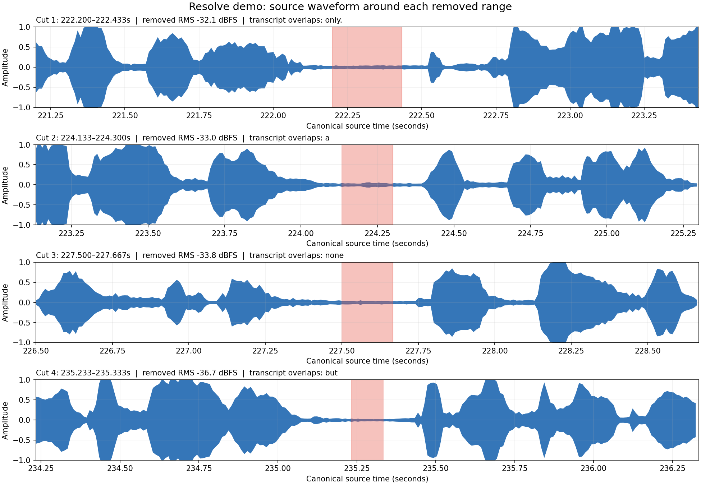

# One recording. A small win worth sharing.

**This project was built with OpenAI Codex**, under Mervin Praison’s direction—from implementation and debugging to tests, documentation, and deployment. It was prepared for the community-led [Cambridge Codex Community Challenge](https://cambridge-codex-workshop-guide.lilizhu.chatgpt.site/challenges.html).

The everyday task: remove quiet pauses from a short video without manually cutting every gap. I asked Codex to help while DaVinci Resolve was open, then reviewed the timeline it created.

<div class="challenge-facts" markdown>
<div markdown>
<span class="step">01 / WHAT I MADE</span>
### An edit I could request in chat
PraisonAI Clips connects Codex to an open video editor. In this example, it creates a version of a clip with quiet pauses removed.
</div>
<div markdown>
<span class="step">02 / WHAT I CHANGED</span>
### Keep the original available
Codex created a separate review timeline, so the new cuts can be compared with the original before sharing.
</div>
<div markdown>
<span class="step">03 / WHAT I CHECKED</span>
### Inspect the result
I checked the result in DaVinci Resolve. It created a separate review timeline with the pauses removed, while keeping the original available.
</div>
</div>

[Download the three-column summary image](assets/challenge/three-columns.png)

## Watch the live editing demo

<video class="challenge-video" controls playsinline preload="metadata" poster="../assets/live-edit/resolve-demo-poster.jpg" aria-label="Screen recording of a request in Codex and a review timeline in DaVinci Resolve"><source src="../assets/live-edit/resolve-demo.mp4" type="video/mp4"><a href="../assets/live-edit/resolve-demo.mp4">Download the live editing demo</a>.</video>

[Watch the 30-second demo directly](assets/live-edit/resolve-demo.mp4) · [See the editor setup](getting-started/codex.md) · [Explore the code](https://github.com/MervinPraison/praisonai-clips)

This screen recording shows the actual request and the resulting Resolve timeline. It is silent and edited to remove waiting, so it is not uninterrupted real-time footage. In this run Codex cleared pending Console input and checked source-frame boundaries after the pause-removal guard rejected the clip; the review timeline was then created through the Resolve scripting route. This recording does not establish that the packaged pause-removal command runs without that intervention. The original timeline remained available.

### What changed after the recording

The pause-removal guard rejected the clip when Resolve reported the final media frame inclusively. [The follow-up fix](https://github.com/MervinPraison/praisonai-clips/commit/f67d591b20d2fcdf2380208455af5078916a125e) accepts that boundary and adds a regression test. The recording predates the fix; it does not show a clean end-to-end run of the updated command. Version 0.1.3 includes the fix.

### The request

> Your shorts is there in the timeline, please remove the silences.

This is one tested operation, not a claim that every natural-language edit is supported. The pause-removal workflow currently requires an unretimed 30 fps clip in a 30 fps Resolve timeline. See the [Resolve SDK guide](reference/resolve-sdk.md) for setup and limitations.

## Checking the cuts

The chart compares the four removed ranges with the source audio. Blue shows the waveform and red marks the removed portion. The values are RMS sound levels, not speech detection. We compared the ranges with estimated word timestamps and existing visual observations sampled every five seconds, then inspected frames immediately before and after each cut.



| Cut | Removed source time | Sound level (RMS) | Review flag |
| --- | --- | --- | --- |
| 1 | 222.200–222.433 s | −32.1 dBFS | Estimated end of “only” overlaps by about 20 ms. |
| 2 | 224.133–224.300 s | −33.0 dBFS | Estimated timing of “a” overlaps. |
| 3 | 227.500–227.667 s | −33.8 dBFS | No estimated word overlaps. |
| 4 | 235.233–235.333 s | −36.7 dBFS | Estimated timing of “but” overlaps; on-screen text also advances across the cut. |

Word timestamps are estimates and can include pauses. An overlap flags a risk, not proof that speech was removed; a quiet waveform cannot prove speech is absent. Five-second visual observations miss events between samples, and before-and-after frames do not show everything removed. Listen to the actual timeline and inspect its visual timing before accepting these cuts.

## Watch the walkthrough

<video class="challenge-video" controls playsinline preload="metadata" poster="../assets/challenge/after-onboarding.png" aria-label="Captioned product walkthrough: what was made, changed, and checked"><source src="../assets/challenge/walkthrough.mp4" type="video/mp4"><a href="../assets/challenge/walkthrough.mp4">Download the captioned walkthrough</a>.</video>

[Open the video directly](assets/challenge/walkthrough.mp4) · [Try the short example](index.md#see-example) · [Explore the code](https://github.com/MervinPraison/praisonai-clips)

The walkthrough records the local application and uses the public generated example. Its word timings and edit are scripted. It demonstrates the renderer, exported files, and first-run experience; it does not depict a new transcription or AI selection run. Real-provider and native-editor validation are documented separately below.

## The request behind the improvement

The request was to make the app understandable and convincing to a new user. The improvement put the upload beside a playable example and added setup checks before processing. The check covered browser playback, the downloadable example bundle, and automated first-run tests. The example uses generated media and scripted captions, so it does not demonstrate a fresh AI selection.

## The improvement you can see

The earlier first-run screen explained the workflow, but the upload lived in a sidebar and visitors could not inspect an example result. The revised screen puts an upload beside a playable clip and a downloadable bundle. It checks for an API key and compatible FFmpeg before enabling processing.

<div class="iteration-images">
<figure><figcaption>Before: explain the workflow and ask the visitor to start from the sidebar.</figcaption></figure>
<figure><figcaption>After: show a result, make the upload visible, and check setup before processing.</figcaption></figure>
</div>

## What the checks establish

| Check | Evidence | Boundary |
| --- | --- | --- |
| Local automated suite | [Historical verification snapshot](assets/challenge/verification.json) and [test source](https://github.com/MervinPraison/praisonai-clips/tree/main/tests) | The snapshot records an earlier macOS run on 29 October 2026, not the current test count. Optional runtime tests are skipped when their dependencies are absent. |
| End-to-end render, repair, and resume | [Pipeline regression](https://github.com/MervinPraison/praisonai-clips/blob/main/tests/test_pipeline.py) uses real FFmpeg output and a clearly labelled synthetic API backend | This test checks application behavior without paid provider calls. |
| Real-video processing | A four-minute validation produced three captioned candidates; one passed review and two remained uncertain drafts. [Read the report](reference/validation-report.md). | A recorded engineering run, rather than a general quality or acceptance-rate claim. |
| First-run behavior | [Onboarding regressions](https://github.com/MervinPraison/praisonai-clips/blob/main/tests/test_onboarding.py) check missing setup, missing input, invalid paths, and the example bundle’s explicit file list | No paid request is started by these tests. |
| Public website | The custom domain serves the example video, documentation, and code links over HTTPS | GitHub Pages hosts static pages. Process personal recordings in the local Streamlit app. |
| Native editor framing | [Kdenlive](KDENLIVE_LIVE_CONTROL.md) and [Resolve](RESOLVE_LIVE_CONTROL.md) reports record framing changes and restoration | Tested workflows are version-dependent; broader operations require separate validation. |

Run the checks yourself:

```sh
python -m pip install -e '.[dev,live]'
pytest -q
```

FFmpeg must include subtitle rendering, audio normalization, and H.264 encoding. Tests for optional local editor runtimes may skip. The [Verify project workflow](https://github.com/MervinPraison/praisonai-clips/actions/workflows/verify.yml) repeats the portable suite on GitHub; it does not connect to a desktop editor or call OpenAI.

## What Codex contributed

The work happened through a cycle of requests, implementation, inspection, and revision: build the processing workflow, test it on real media, add guarded editor control, simplify the first visit, check privacy, and publish the site. The improvement above came from asking Codex to make the experience convincing to a new visitor, then checking the result with actual browser playback, a downloaded ZIP, and automated first-run tests.

The project uses OpenAI, FFmpeg, Streamlit, MkDocs Material, and optional editor integrations. Existing third-party code, fonts, and license notices retain their attribution.

## Try the small win

[Watch the generated example](index.md#see-example), [run the local app](getting-started/quickstart.md), or [inspect the SDK](reference/resolve-sdk.md). Your final publishing decision stays with you: preview the framing, check the captions, and listen to the clip.
