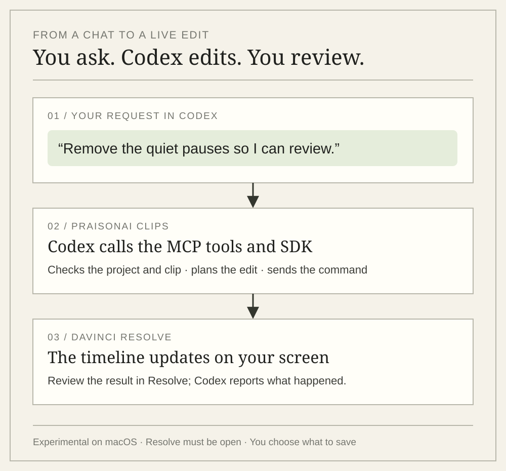

<div class="edition"><span>PRAISONAI CLIPS</span><span>AI VIDEO REPURPOSING</span><span>CREATE · REVIEW · REFINE</span></div>
<div class="hero" markdown>
<div markdown>
<p class="eyebrow">YOUR RECORDING HAS MORE TO GIVE</p>
<h1>Your long video.<br><em>Your next short.</em></h1>
<p class="lede">Find complete moments in your interviews, lessons, and webinars. Turn them into vertical clips with highlighted captions, then review and choose what to share.</p>
<div class="actions"><a class="paper-button" href="getting-started/quickstart/">Make my first clips ↗</a><a class="paper-button secondary" href="#see-example">Watch the example</a><a class="paper-button secondary github-button" href="https://github.com/MervinPraison/praisonai-clips"><svg aria-hidden="true" focusable="false" xmlns="http://www.w3.org/2000/svg" viewBox="0 0 512 512"><!--! Font Awesome Free 7.1.0 by @fontawesome - https://fontawesome.com License - https://fontawesome.com/license/free (Icons: CC BY 4.0, Fonts: SIL OFL 1.1, Code: MIT License) Copyright 2025 Fonticons, Inc.--><path d="M173.9 397.4c0 2-2.3 3.6-5.2 3.6-3.3.3-5.6-1.3-5.6-3.6 0-2 2.3-3.6 5.2-3.6 3-.3 5.6 1.3 5.6 3.6m-31.1-4.5c-.7 2 1.3 4.3 4.3 4.9 2.6 1 5.6 0 6.2-2s-1.3-4.3-4.3-5.2c-2.6-.7-5.5.3-6.2 2.3m44.2-1.7c-2.9.7-4.9 2.6-4.6 4.9.3 2 2.9 3.3 5.9 2.6 2.9-.7 4.9-2.6 4.6-4.6-.3-1.9-3-3.2-5.9-2.9M252.8 8C114.1 8 8 113.3 8 252c0 110.9 69.8 205.8 169.5 239.2 12.8 2.3 17.3-5.6 17.3-12.1 0-6.2-.3-40.4-.3-61.4 0 0-70 15-84.7-29.8 0 0-11.4-29.1-27.8-36.6 0 0-22.9-15.7 1.6-15.4 0 0 24.9 2 38.6 25.8 21.9 38.6 58.6 27.5 72.9 20.9 2.3-16 8.8-27.1 16-33.7-55.9-6.2-112.3-14.3-112.3-110.5 0-27.5 7.6-41.3 23.6-58.9-2.6-6.5-11.1-33.3 2.6-67.9 20.9-6.5 69 27 69 27 20-5.6 41.5-8.5 62.8-8.5s42.8 2.9 62.8 8.5c0 0 48.1-33.6 69-27 13.7 34.7 5.2 61.4 2.6 67.9 16 17.7 25.8 31.5 25.8 58.9 0 96.5-58.9 104.2-114.8 110.5 9.2 7.9 17 22.9 17 46.4 0 33.7-.3 75.4-.3 83.6 0 6.5 4.6 14.4 17.3 12.1C436.2 457.8 504 362.9 504 252 504 113.3 391.5 8 252.8 8M105.2 352.9c-1.3 1-1 3.3.7 5.2 1.6 1.6 3.9 2.3 5.2 1 1.3-1 1-3.3-.7-5.2-1.6-1.6-3.9-2.3-5.2-1m-10.8-8.1c-.7 1.3.3 2.9 2.3 3.9 1.6 1 3.6.7 4.3-.7.7-1.3-.3-2.9-2.3-3.9-2-.6-3.6-.3-4.3.7m32.4 35.6c-1.6 1.3-1 4.3 1.3 6.2 2.3 2.3 5.2 2.6 6.5 1 1.3-1.3.7-4.3-1.3-6.2-2.2-2.3-5.2-2.6-6.5-1m-11.4-14.7c-1.6 1-1.6 3.6 0 5.9s4.3 3.3 5.6 2.3c1.6-1.3 1.6-3.9 0-6.2-1.4-2.3-4-3.3-5.6-2"/></svg><span>View on GitHub</span></a></div>
<p class="hero-note">Watch the example without an API key. Process your own video in the local app.</p>
<p class="hero-note">Built entirely using OpenAI Codex and prepared for the Cambridge Codex Community Challenge. <a href="built-with-codex/">See what we made and checked ↗</a> · <a href="getting-started/codex/">Connect Codex to your editor ↗</a></p>
<div class="editor-support" aria-label="Real-time editor integrations">
<span class="editor-support-label">REAL-TIME EDITING</span>
<div class="editor-support-links"><a href="reference/resolve-sdk/"><span>DaVinci Resolve ↗</span></a><a href="KDENLIVE_LIVE_CONTROL/"><span>Kdenlive ↗</span></a></div>
</div>
</div>
<figure class="demo-showcase" id="see-example">
<div class="demo-heading"><span>SEE WHAT YOU CAN TAKE AWAY</span><span>00:12</span></div>
<video controls playsinline preload="metadata" poster="assets/demo/poster.jpg" aria-label="A twelve-second generated vertical clip with scripted word-highlight captions"><source src="assets/demo/clip.mp4" type="video/mp4">Your browser does not support embedded video. <a href="assets/demo/clip.mp4">Download the example clip</a>.</video>
<figcaption>Silent generated example with scripted captions. Rendered with the app's video and caption pipeline; no AI selection or editorial review was run.</figcaption>
<div class="demo-downloads"><a href="assets/demo/clip.mp4" download>Download the clip ↗</a><a href="assets/demo/source.mp4">Compare the original</a></div>
</figure>
</div>
<div class="section-heading"><span class="eyebrow">EDIT BY CHATTING WITH CODEX</span><span>See changes in your editor.</span></div>
<p>Ask Codex to adjust framing in DaVinci Resolve or Kdenlive while you watch. In Resolve, you can also create a review timeline with quiet pauses removed. The Python SDK, MCP tools, CLI and YAML commands share the same guarded operations. <a href="reference/resolve-sdk/">Explore live Resolve editing ↗</a></p>
<figure class="codex-flow"><figcaption>From a request in Codex to a result you can review in Resolve.</figcaption></figure>
<div class="value-strip"><div><strong>Complete thoughts</strong><span>Transcript + visual context</span></div><div><strong>Review before delivery</strong><span>Accepted clips & separate drafts</span></div><div><strong>Keep editorial control</strong><span>Source mappings & editor tools</span></div></div>
<div class="section-heading"><span class="eyebrow">BUILT FOR THE RECORDINGS YOU ALREADY MAKE</span><span>One workflow. More places to start.</span></div>
<div class="feature-grid" markdown>
<div markdown>
<span class="step">FOR CREATORS</span>
### Let the moment stand alone
Find complete thoughts inside an interview or longer conversation. Give each clip its own beginning and ending.
</div>
<div markdown>
<span class="step">FOR EDUCATORS</span>
### Keep the explanation intact
Make short lessons from longer recordings. Preserve slides and screen content with full-frame fit when a crop would lose context.
</div>
<div markdown>
<span class="step">FOR CONTENT TEAMS</span>
### Make the handoff inspectable
Review the result, download the video and caption files, and keep the source mappings available for the next edit.
</div>
</div>
<div class="section-heading"><span class="eyebrow">FROM SOURCE TO SHORT</span><span>Automation with an editorial checkpoint.</span></div>
<div class="process-grid" markdown>
<div markdown>
<span class="step">01 / FIND</span>
### Choose a complete thought
Measured transcription and sampled frames inform moment selection. Candidate ranges respect sentence and duration constraints.
</div>
<div markdown>
<span class="step">02 / PRODUCE</span>
### Frame, caption, render
Create vertical video with a stable crop or full-frame fit, word-highlight captions, and normalized audio.
</div>
<div markdown>
<span class="step">03 / REVIEW</span>
### Check before accepting
Run technical checks and sampled visual review. Attempt supported framing repairs and keep uncertain results in drafts.
</div>
<div markdown>
<span class="step">04 / REFINE</span>
### Keep the final say
Preview, listen, and download. Explore native framing in Kdenlive or DaVinci Resolve when the cut needs a human finish.
</div>
</div>
<div class="section-heading"><span class="eyebrow">WORKING SOFTWARE. INSPECTABLE EVIDENCE.</span><span>See what has been tested.</span></div>
<div class="start-grid proof-grid" markdown>
<div markdown>
## The workflow is running.<br><em>The evidence is open.</em>
Real-video processing has produced captioned vertical clips with explicit review outcomes. Native editor tests have verified live framing changes and restoration against exported frames.
[Explore the product and validation](product.md) · [Read the processing report](reference/validation-report.md)
</div>
<div class="evidence-card" markdown>
<span class="step">CURRENT PRODUCT · 0.1.0</span>
### Build on a working foundation
- Local dashboard, CLI, and resumable jobs
- Video, captions, edit mappings, and review artifacts
- Python SDK, CLI, YAML, and Resolve MCP tools
- Live Kdenlive and Resolve integrations

Live adapters have version constraints. Automated review uses sampled frames; inspect and listen before publishing.
</div>
</div>
<div class="section-heading"><span class="eyebrow">START WITH YOUR NEXT RECORDING</span><span>Python · OpenAI · FFmpeg</span></div>
<div class="start-grid" markdown>
<div markdown>
## Bring a video.<br><em>Find its next story.</em>
Start in the dashboard or run a job from the command line. OpenAI processes audio and sampled frames; job state and output files stay in your local workspace. API usage is billed to your account.
[Install the prerequisites](getting-started/installation.md) · [Read about data handling](reference/public-release.md)
</div>
<div markdown>
```sh
# Install the package and open the dashboard
python -m pip install praisonai-clips
praisonai-clips studio

# Check prerequisites or process from the command line
praisonai-clips doctor
praisonai-clips run '/absolute/path/to/video.mp4'

# Source checkout also supports: streamlit run app.py
```
</div>
</div>
