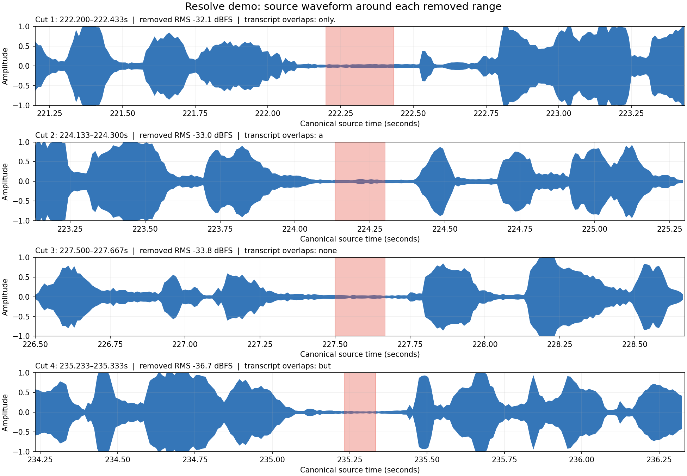
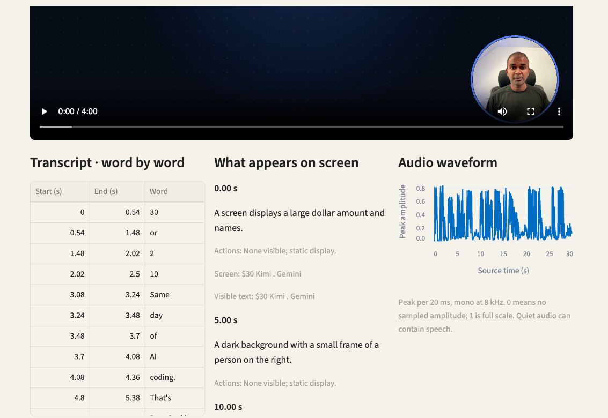

Mervin Praison uses this app to make Shorts for [his YouTube channel](https://www.youtube.com/@MervinPraison/). You can watch a real example without an API key. [Connect Codex to your editor](getting-started/codex.md).

## See an example

One of five clips the app made from a 14-minute RAG tutorial. It keeps the full slide visible and adds highlighted captions. This is a review draft; check the video and audio before publishing.

<video controls playsinline preload="metadata" poster="assets/real-example/poster.jpg">
  <source src="assets/real-example/short.mp4" type="video/mp4">
</video>

[Download the Short](assets/real-example/short.mp4) · [Watch the full original](https://www.youtube.com/watch?v=pIGRwMjhMaQ) · [Download captions](assets/real-example/captions.srt)

## How it works

1. **Add a video.** Upload a file or choose one on your computer.
2. **Make shorts.** The app finds moments, frames them, and adds captions.
3. **Keep editing.** Optionally ask Codex to edit in DaVinci Resolve or Kdenlive.

## Install and open the app

Install PraisonAI Clips, then open its dashboard. You need Python 3.11 or newer, a compatible FFmpeg installation, and an OpenAI API key.

```sh
python -m pip install praisonai-clips
praisonai-clips studio
```

[Step-by-step installation](getting-started/installation.md) · [How data is handled](reference/public-release.md)

## Edit by chatting with Codex

Ask Codex to adjust framing in DaVinci Resolve or Kdenlive while you watch. In Resolve, you can also create a review timeline with quiet pauses removed. The Python SDK, MCP tools, CLI, and YAML commands share the same guarded operations.

[Explore live Resolve editing](reference/resolve-sdk.md)

<video controls playsinline preload="metadata" poster="assets/live-edit/resolve-demo-poster.jpg">
  <source src="assets/live-edit/resolve-demo.mp4" type="video/mp4">
</video>

Ask Codex to remove quiet pauses, then see a separate review timeline appear in Resolve. This screen recording is shortened to remove waiting. It has no narration.



Blue shows the source waveform. Red marks the four ranges removed in the demo. [See the cut-by-cut evidence](built-with-codex.md#checking-the-cuts).

## Source evidence

After uploading a video or choosing a local path, start processing, select the recording, and open **Source evidence**. Compare words, picture, and sound in the same time window.



Word timings are estimates. Screen descriptions come from sampled frames. The panel makes no additional AI calls. [Open the dashboard guide](getting-started/quickstart.md#use-the-dashboard).

## Tested on real video

A four-minute recording produced three captioned clips. One passed automated review and two stayed in drafts. Live framing was also tested in DaVinci Resolve and a custom Kdenlive setup.

[Read the test results](reference/validation-report.md) · [See supported editor setups](product.md)

The latest source checkout also trims detected quiet pauses during Shorts rendering. PyPI 0.1.3 does not yet include that change. The tested Mac Kdenlive integration needs a custom bridge from the source checkout.
